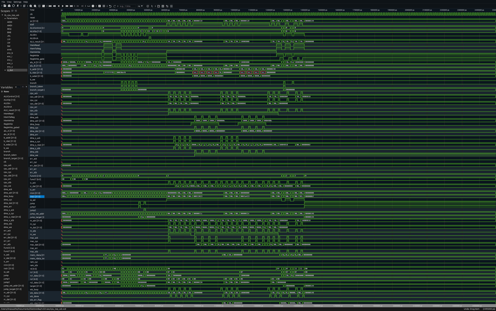
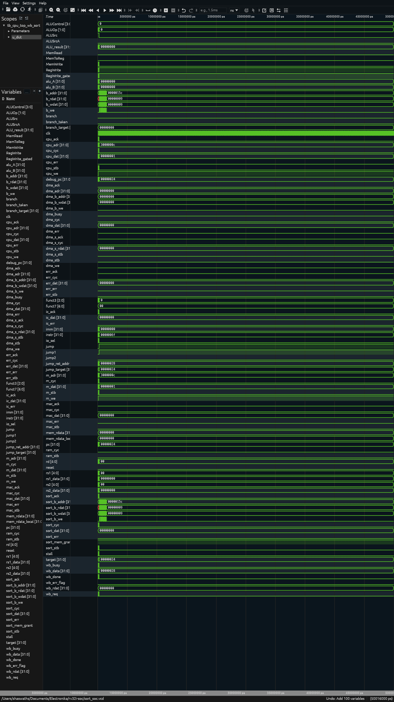

# RV32I SoC

A single-cycle RISC-V RV32I core in Verilog, extended into a small SoC: a Wishbone B4 Classic bus, a MAC accelerator, a merge-sort accelerator, a DMA controller, and an error slave. The core executes one instruction per clock cycle (**Fetch → Decode → Execute → Memory → Writeback**, wired combinationally) and stalls only on bus (IO) accesses and while the DMA is copying. Simulated with [Icarus Verilog](https://steveicarus.github.io/iverilog/); a self-checking SoC testbench verifies the demo program and a MAC dot-product whose operands are copied in by the DMA, and the core passes all 37 official `rv32ui` tests.

## Table of Contents

- [Repository Structure](#repository-structure)
- [CPU Datapath](#cpu-datapath)
- [Supported Instructions](#supported-instructions)
- [Wishbone Bus](#wishbone-bus)
- [Accelerators and Analysis](#accelerators-and-analysis)
- [DMA Controller](#dma-controller)
- [Waveform Output](#waveform-output)
- [Setup](#setup)
- [Compile & Run](#compile--run)
- [Verification](#verification)
- [License](#license)

## Repository Structure

```
rv32i-soc/
├── README.md
├── LICENSE
├── Makefile                           # make run / compile / bus / clean
├── program_sort.hex                   # 10-word driver for tb_cpu_top_wb_sort.v
├── build/                             # Generated simulation outputs (gitignored)
├── documentation/
│   ├── RV32I_Processor_Control_Signals.md
│   ├── data_path.png
│   ├── media/
│   │   ├── waveform_mac.png           # tb_cpu_top_wb_mac.v (DMA + MAC) waveform
│   │   └── waveform_sort.png          # tb_cpu_top_wb_sort.v waveform
│   └── riscv-tests/
│       ├── VERIFICATION.md            # Official rv32ui verification report
│       └── REPRODUCING.md             # Re-run any single official test
└── hardware/
    ├── src/
    │   ├── bus/
    │   │   ├── wb_defs.vh             # Address-map / bus macros
    │   │   ├── wb_master.v            # CPU-side Wishbone master
    │   │   ├── wb_interconnect.v      # Address decode + slave mux
    │   │   ├── wb_mac_accel.v         # MAC accelerator slave
    │   │   ├── wb_dma.v               # DMA controller (slave registers + bus master)
    │   │   ├── wb_sort.v              # Merge-sort accelerator (slave registers + data_memory port B)
    │   │   ├── wb_err.v               # Catch-all error slave
    │   │   └── wb_ram.v               # Testbench-only RAM slave
    │   └── core/
    │       ├── cpu_top_wb.v           # SoC top: core + bus + peripherals
    │       ├── if/
    │       │   ├── inst_mem.v         # Instruction memory (PROG_FILE parameter)
    │       │   ├── program_counter.v  # PC update logic with branch/jump support
    │       │   ├── program.hex        # 56-word demo program
    │       │   └── program2.hex       # Official rv32ui image
    │       ├── id/
    │       │   ├── branch.v           # Branch condition and target generation
    │       │   ├── control_unit.v     # Opcode decode and control signals
    │       │   ├── immediate_gen.v    # Immediate generation
    │       │   └── jump.v             # JAL / JALR target logic
    │       ├── ex/
    │       │   ├── alu_control.v      # Decodes ALU op, funct3/funct7
    │       │   ├── alu_module.v       # Arithmetic / logical ALU
    │       │   ├── alu_src_mux.v      # Selects rs2_data or immediate for ALU input B
    │       │   └── reg_file.v         # 32 x 32 register file
    │       ├── mem/
    │       │   ├── data.hex           # Zero-initialised data memory
    │       │   └── data_memory.v      # Local data memory (dual-port: A = CPU, B = DMA)
    │       └── wb/
    │           └── writeback_mux.v    # Selects ALU result, memory data, or return address
    └── test_bench/
        ├── tb_cpu_top_wb_mac.v        # Self-checking SoC testbench (DMA + MAC), make run
        ├── tb_cpu_top_wb_sort.v       # Self-checking SoC testbench (SORT), make sort
        ├── rv32i_asm.vh               # Tiny RV32I assembler functions
        ├── dma_driver.vh              # Used by make run: DMA copies vectors into MAC, computes dot product
        ├── mac_driver.vh              # CPU-copy baseline driver (not used by make run)
        ├── bus/
        │   ├── tb_wb_ram.v
        │   ├── tb_wb_master.v
        │   ├── tb_wb_integ.v
        │   ├── tb_wb_mac_accel.v
        │   ├── tb_wb_dma.v
        │   ├── tb_wb_sort.v
        │   └── tb_wb_data.hex
        └── stage/                     # Per-stage unit testbenches (ex, id, if, mem, wb)
            └── mem/tb_dp_mem.v        # Dual-port data_memory testbench
```

## SoC Datapath


The diagram shows the RISC V core, Wishbone bus, DMA integrations and Slaves.

## Supported Instructions

The current RTL implements a RV32I-style integer core with the following instruction groups:

| Type | Instructions |
|------|-------------|
| **R-type** | `ADD`, `SUB`, `AND`, `OR`, `XOR`, `SLL`, `SRL`, `SRA`, `SLT`, `SLTU` |
| **I-type ALU** | `ADDI`, `ANDI`, `ORI`, `XORI`, `SLLI`, `SRLI`, `SRAI`, `SLTI`, `SLTIU` |
| **Load** | `LB`, `LH`, `LW`, `LBU`, `LHU` |
| **Store** | `SB`, `SH`, `SW` |
| **Branch** | `BEQ`, `BNE`, `BLT`, `BGE`, `BLTU`, `BGEU` |
| **Jump / link** | `JAL`, `JALR` |
| **U-type** | `LUI`, `AUIPC` |

This matches the control decode and ALU handling implemented in `control_unit.v`, `alu_control.v`, and `jump.v`.

## Wishbone Bus

Top level is [`cpu_top_wb.v`](hardware/src/core/cpu_top_wb.v) (module `cpu_top_wb`, ports `clk`, `reset`). It instantiates `wb_master` (`u_wb_master`), `wb_interconnect` (`u_wb_ic`), `wb_mac_accel` (`u_mac`), `wb_dma` (`u_dma`), `wb_sort` (`u_sort`) and `wb_err` (`u_wb_err`). It also exposes a `debug_pc` output (the current `pc`).

```
                  ┌────────────┐   ┌───────┐   ┌───────────────┐   ┌──────────────┐
  RV32I core ───► │ wb_master  │──►│  2:1  │──►│ wb_interconn. │──►│ wb_mac_accel │  0x1000_xxxx
  (io_sel=1)      └────────────┘   │  mux  │   │               │   └──────────────┘
                  ┌────────────┐   │       │   │               │   ┌──────────────┐
                  │ wb_dma     │──►│       │   │               │──►│ wb_dma regs  │  0x2000_xxxx
                  │ (master)   │   └───▲───┘   │               │   └──────────────┘
                  └─────┬──────┘       │       │               │   ┌──────────────┐
                        │ port B    dma_busy   │               │──►│  wb_sort     │  0x3000_xxxx
                        │              │       │               │   └──────┬───────┘
                        │              │       │               │   ┌──────┼───────┐
                        │              │       └───────────────┘──►│   wb_err     │  everything else
                        ▼              ▼                           └──────┼───────┘
  RV32I core ───► data_memory (dual-port, 0x0000_0000-0x0000_FFFF) ◄──────┘ sort (port B, idle-DMA only)
  (io_sel=0)  port A
```

`u_dma` appears twice: as a slave (its register page) and as a second bus master. The 2:1 mux hands the bus to the DMA while `dma_busy` is high; `ACK`/`ERR` go only to the current owner, read data goes to both. `u_sort` is a plain slave on the bus but reaches `data_memory` through port B, which it shares with the DMA: while `dma_busy` is high the DMA owns port B and the sorter pauses (`sort_mem_grant = ~dma_busy`).

**Flavour:** Wishbone Classic, non-pipelined, zero wait-state (`ACK` is combinational, `cyc & stb`), word-only. There is no `SEL`, so `SB`/`SH` to IO space write a full word. Signals: `CYC`, `STB`, `WE`, `ADR`, `DAT` (master to slave); `ACK`, `ERR`, `DAT` (slave to master). `ADDR_WIDTH = DATA_WIDTH = 32`. `wb_master` runs an effective IDLE → ACTIVE → IDLE FSM.

<details>
<summary><b>IO split</b></summary>

Local `data_memory` owns `0x0000_0000`-`0x0000_FFFF`. A load/store goes to the bus when `(MemRead | MemWrite) & ALU_result[31:16] != 0`:

| Signal | Definition |
|--------|-----------|
| `io_sel` | Access targets the bus |
| `dma_busy` | DMA is copying: it owns the bus and the CPU is frozen |
| `wb_req` | `io_sel & ~wb_busy & ~wb_done & ~dma_busy` |
| `stall` | `~wb_done & (io_sel \| dma_busy)` (freezes the PC) |
| Port A write | `MemWrite & ~io_sel & ~dma_busy` (a frozen `SW` cannot collide with DMA port B) |
| `RegWrite_gated` | `RegWrite & ~stall` |
| `mem_rdata` | `io_sel ? wb_rdat : mem_rdata_local` |

A bus store takes 3 core cycles (4 to `wb_sort`, whose `ACK` is registered); a local load takes 1.

</details>

<details>
<summary><b>Address map (decoded in `wb_interconnect.v`)</b></summary>

| Slave | Select | Range | Notes |
|-------|--------|-------|-------|
| `wb_ram` | `adr[31:10] == 0` | `0x0000_0000`-`0x0000_03FF` (1 KB) | **Not instantiated in the SoC**; RAM port is stubbed. Local `data_memory` handles this range |
| `wb_mac_accel` | `adr[31:16] == 16'h1000` | `0x1000_0000`-`0x1000_FFFF` (64 KB) | See below |
| `wb_dma` | `adr[31:16] == 16'h2000` | `0x2000_0000`-`0x2000_FFFF` (64 KB) | DMA register page, aliased every 32 B; see [DMA Controller](#dma-controller) |
| `wb_sort` | `adr[31:16] == 16'h3000` | `0x3000_0000`-`0x3000_FFFF` (64 KB) | Sort register page, decoded on `adr[5:2]` (aliased every 64 B); see [Accelerators and Analysis](#accelerators-and-analysis) |
| `wb_err` | catch-all (`~sel_ram & ~sel_mac & ~sel_dma & ~sel_sort`) | everything else | Always `ERR`, never `ACK`, reads 0 |

Bus errors are observed, not trapped: `wb_err_flag` is observation-only and there is no trap. `o_irq` of the MAC is tied off.

</details>

## Accelerators and Analysis

Two bus slaves offload work from the CPU. Expand each for its register map, usage sequence and performance. Cycle totals marked *simulated* come from the testbench; those marked *estimate* are derived by hand and not measured.

<details>
<summary><b>MAC Accelerator</b></summary>

[`wb_mac_accel.v`](hardware/src/bus/wb_mac_accel.v) computes `acc += SUM(A[i] * B[i])`, signed 32x32 to 64-bit, one element per clock. Params: `ADDR_WIDTH=16`, `DATA_WIDTH=32`, `BUF_AW=12` (4096-word buffers). `DONE` appears `LEN + 2` posedges after the `START` write.

<details>
<summary><b>Register map</b></summary>

| Address | Name | Access | Description |
|---------|------|--------|-------------|
| `0x1000_0000` (+`0x0000`-`0x3FFF`) | `BUF_A` | R/W | 4096 words |
| `0x1000_4000` (+`0x4000`-`0x7FFF`) | `BUF_B` | R/W | 4096 words |
| `0x1000_8000` | `CTRL` | W | bit0 `START` (self-clearing; ignored if busy or `LEN == 0`), bit1 `CLR_ACC` (self-clearing) |
| `0x1000_8004` | `STATUS` | R/W1C | bit0 `BUSY` (RO), bit1 `DONE` (sticky, write 1 to clear) |
| `0x1000_8008` | `LEN` | R/W | Element count, clamps to 4096, ignored while busy |
| `0x1000_800C` | `ACC_LO` | R/W | Accumulator [31:0], writes ignored while busy |
| `0x1000_8010` | `ACC_HI` | R/W | Accumulator [63:32], writes ignored while busy |

Registers at `0x1000_8000`+ alias every 32 bytes. The accumulator is **not** auto-cleared between runs.

</details>

**Sequence:** `CLR_ACC` → fill `BUF_A` / `BUF_B` (done by the DMA in `make run`) → write `LEN` → `START` → poll `STATUS.DONE` → read `ACC_LO` / `ACC_HI` → write `STATUS = 2` to clear `DONE`.

**Performance:** the MAC itself takes 1 cycle per element regardless of the data; a software MAC's cost depends on operand width. With the DMA feeding it, data movement dominates (8 of ~9 cycles per element).

<details>
<summary>Measured totals vs software estimate</summary>

Accelerator totals are **simulated** (`DRV_BASE` → `DRV_DONE`, N = 1..256). The DMA route fits `T = 8N + 5*ceil((N-1)/5) + 51 ≈ 9N + 51`; the CPU-copy route (`mac_driver.vh`) is ≈ `15N + 29`.

| N | DMA route (cycles) | CPU-copy route (cycles) |
|---|-----|-----|
| 4 | 88 | 90 |
| 16 | 194 | 268 |
| 64 | 628 | 990 |
| 256 | 2354 | 3868 |

The software MAC is an **estimate**, not measured: RV32I has no `M` extension, so each multiply is a shift-add routine whose cost depends on data width.

| Operand width | Software cycles/element (est.) | Speed-up vs CPU copy (15/elem) | Speed-up vs DMA (9/elem) |
|---|---|---|---|
| Tiny, ≤ 4-bit (demo data) | ~40 | ~2.7x | ~4.4x |
| 16-bit operands, 32-bit result | ~106 | ~7.1x | ~11.8x |
| Full signed 32x32 → 64 | ~339 | ~22.6x | ~37.7x |

</details>

</details>

<details>
<summary><b>SORT Accelerator</b></summary>

[`wb_sort.v`](hardware/src/bus/wb_sort.v) sorts `LEN` 32-bit words into ascending order (**unsigned** compare) with a bottom-up merge sort: run width 1, 2, 4, … doubles each pass, ping-ponging between the `SRC` and `DST` buffers. If the last pass lands in `SRC` it copies the result back to `DST`, so the sorted data is always at `DST`. **`SRC` is overwritten** with intermediate runs. Both buffers are in the local `data_memory`, which the sorter reaches through port B, so addresses must be below `0x0001_0000`.

<details>
<summary><b>Register map</b></summary>

| Address | Name | Access | Description |
|---------|------|--------|-------------|
| `0x3000_0000` | `SRC` | R/W | Source buffer byte address |
| `0x3000_0004` | `DST` | R/W | Destination buffer byte address (sorted result) |
| `0x3000_0008` | `LEN` | R/W | Word count; `0` finishes immediately, `1` copies (or does nothing if `SRC == DST`) |
| `0x3000_000C` | `CTRL` | W | bit0 `START` (one-cycle pulse; only acted on in `IDLE`) |
| `0x3000_0010` | `STATUS` | R | bit0 `BUSY`, bit1 `DONE` |

Registers are selected by `adr[5:2]`, so the page aliases every 64 bytes. Unlike the MAC and DMA, `DONE` is **not** write-1-to-clear: it stays set until the next `START`. Register writes are not blocked while busy, so do not change `SRC`/`DST`/`LEN` mid-sort.

</details>

**Sequence:** write `SRC` → `DST` → `LEN` → `START` → poll `STATUS.DONE` → read the sorted words from `DST`. The CPU is **not** stalled while sorting (unlike the DMA), so software must poll and must not touch the buffers meanwhile; a CPU store into `data_memory` in the same cycle as a sorter write wins and the sorter's write is dropped.

**DMA interaction:** if the DMA starts during a sort, the sorter holds its pending write and resumes when `dma_busy` falls (checked by `tb_wb_sort`).

**Performance:** a merge step takes 5 cycles while both runs have data (`MERGE → READ_LEFT → READ_RIGHT → WRITE_OUT → ADVANCE`) and 4 once one run is exhausted, so the sorter costs about 5.4 cycles per element per pass (`p = ⌈log2 N⌉` passes), independent of the value width. The CPU is free while it runs.

<details>
<summary>Measured totals vs software estimate</summary>

Sorter totals are **simulated** (`START` write to `DONE`, `wb_sort` driven directly on the bus with a zero-wait memory, DMA idle, in a scratch bench not in the repo). The fit is `T ≈ 5.4·N·p`, bounded above by `5·N·p + N + 2p + 5` (+ `3N` copy-back when `p` is even).

| N | Passes | Random data (cycles) | Reversed data (cycles) |
|---|---|-----|-----|
| 8 | 3 | 128 | 125 |
| 16 | 4 | 378 | 363 |
| 64 | 6 | 2114 | 1999 |
| 256 | 8 | 10967 | 10259 |

The software sort is an **estimate**, not measured: a merge loop on RV32I needs roughly 12-18 instructions per element per pass (two loads, compare, branch, store, pointer and bounds updates; 1 cycle each on this core).

| Software merge loop | Software cycles/element-pass (est.) | Speed-up vs sorter (~5.4/elem-pass) |
|---|---|---|
| Tight, hand-scheduled | ~12 | ~2.2x |
| Typical | ~15 | ~2.8x |
| Compiler output, bounds checks | ~18 | ~3.3x |

For N = 256 that is ~24.6k-36.9k software cycles against 10,967 for the sorter (the speed-up holds at ~2.0x-3.4x for all N above). The gain is modest because the sorter is a serial FSM on a single memory port, so its main benefit is freeing the CPU. Register setup (four bus stores) is not included.

</details>

**Tests:** `tb_wb_sort` (bus-level, 103 tests over many lengths and patterns, 96 with a DMA interruption; prints `ALL TESTS PASSED`) and `tb_cpu_top_wb_sort` (the CPU runs `program_sort.hex`, programs the sorter and sorts 8 words at `0x100` into `0x140`; prints `PASS: CPU-driven SORT integration test passed.`). Run it with `make sort` (not part of `make run`).

</details>

## DMA Controller

[`wb_dma.v`](hardware/src/bus/wb_dma.v) is a single-channel word-copy engine: any address to any address. It is a slave at `0x2000_0000` (the CPU programs its registers) and a second bus master (it moves the data).

<details>
<summary><b>Register map</b></summary>

| Address | Name | Access | Description |
|---------|------|--------|-------------|
| `0x2000_0000` | `SRC` | R/W | Source byte address; live, +4 per word |
| `0x2000_0004` | `DST` | R/W | Destination byte address; live, +4 per word |
| `0x2000_0008` | `LEN` | R/W | Words left; live, −1 per word, reads 0 after a full copy |
| `0x2000_000C` | `CTRL` | W | bit0 `START` (self-clearing; ignored if busy or `LEN == 0`) |
| `0x2000_0010` | `STATUS` | R/W1C | bit0 `BUSY` (RO), bit1 `DONE`, bit2 `ERR` (sticky, write 1 to clear) |

Registers alias every 32 bytes across `0x2000_0000`-`0x2000_FFFF`. `addr[1:0]` is ignored (word-only). `SRC`/`DST`/`LEN`/`CTRL` writes are ignored while busy.

</details>

**Routing:** each side of the copy is chosen by address, like the CPU's `io_sel`. `addr[31:16] == 0` uses local `data_memory` port B (1 cycle, off the bus); anything else goes over the bus through the DMA's internal `wb_master` (3 cycles).

| Copy | Cycles/word |
|------|-------------|
| local → bus | 4 |
| bus → local | 4 |
| local → local | 2 |
| bus → bus | 6 |

**CPU halt:** while `BUSY` the CPU is frozen (`stall` includes `dma_busy`) and the bus mux gives the DMA ownership, so there is no polling: the `SW` to `CTRL` acts like a blocking `memcpy`, and the next instruction runs after the copy is done.

**Errors:** a bus `ERR` stops the copy early without advancing `SRC`/`DST`/`LEN`, and sets `DONE` and `ERR`.

**Sequence:** write `SRC` → `DST` → `LEN` → `START` (optionally check `STATUS.ERR` afterwards).

## Waveform Output

The self-checking testbench [`tb_cpu_top_wb_mac.v`](hardware/test_bench/tb_cpu_top_wb_mac.v) checks the 56-instruction demo program cycle by cycle, then runs a DMA driver at `0xE0` that copies vectors into the MAC over the DMA controller and computes `dot([1,2,3,4],[5,6,7,8]) = 70`, printing `PASS: all checks passed`. It writes `cpu_top_wb.vcd` in the repo root (the working directory).

Two waveforms are captured, one per SoC testbench.

**MAC + DMA** ([`tb_cpu_top_wb_mac.v`](hardware/test_bench/tb_cpu_top_wb_mac.v), `make run`, writes `cpu_top_wb.vcd`):



**SORT** ([`tb_cpu_top_wb_sort.v`](hardware/test_bench/tb_cpu_top_wb_sort.v), `make sort`, writes `sort_soc.vcd`): the CPU runs `program_sort.hex`, programs the sorter and sorts 8 words from `0x100` into `0x140`, printing `PASS: CPU-driven SORT integration test passed.`



Refer to [Processor_Control_Signals](documentation/RV32I_Processor_Control_Signals.md) for explanation of what these signals mean.

## Setup

<details>
<summary><b>Prerequisites</b></summary>

1. **Icarus Verilog** — open-source Verilog simulation and synthesis tool.

   Download and install from the official site: [https://steveicarus.github.io/iverilog/](https://steveicarus.github.io/iverilog/)

   Or install via a package manager:

   ```bash
   # macOS (Homebrew)
   brew install icarus-verilog

   # Ubuntu / Debian
   sudo apt install iverilog

   # Arch Linux
   sudo pacman -S iverilog
   ```

2. **Waveform Viewer** — to inspect `.vcd` signal dumps.

   Install any waveform viewer that supports VCD files. Recommended options:

   - [GTKWave](https://gtkwave.github.io/gtkwave/) — classic, widely-used VCD viewer
   - [Surfer](https://surfer-project.org/) — modern, fast waveform viewer

</details>

## Compile & Run

All commands are run from the repository root.

### 1. Compile & Execute

```bash
make run
```

This builds the SoC with [`tb_cpu_top_wb_mac.v`](hardware/test_bench/tb_cpu_top_wb_mac.v), simulates it, and exits non-zero if any check fails (`vvp` itself always exits 0, so the Makefile scans the log for `FAIL`). A successful run ends with:

```text
VCD info: dumpfile cpu_top_wb.vcd opened for output.
DMA driver: 88 cycles (DRV_BASE -> DRV_DONE, N=4)
PASS: all checks passed
```

`$readmemh` "Not enough words" warnings are expected. The waveform is written to `cpu_top_wb.vcd` in the repo root, and the log to `build/cpu_tb.log`.

<details>
<summary><b>Compile by hand</b></summary>

To compile by hand instead:

```bash
mkdir -p build
iverilog -I hardware/src/bus -I hardware/test_bench -o build/cpu_tb.out \
  $(find hardware/src -name '*.v' ! -name 'wb_ram.v') \
  hardware/test_bench/tb_cpu_top_wb_mac.v && vvp build/cpu_tb.out
```

</details>

<details>
<summary><b>Makefile targets</b></summary>

```bash
make run      # compile + simulate the MAC/DMA SoC testbench, fail on any FAIL
make sort     # compile + simulate the SORT SoC testbench (loads program_sort.hex), fail on any FAIL
make compile  # compile only, build/cpu_tb.out
make bus      # run all six bus testbenches, stop at the first failure
make clean    # remove build artifacts and *.vcd
```

</details>

<details>
<summary><b>Bus testbenches</b></summary>

`make bus` runs `tb_wb_ram` (35), `tb_wb_master` (32), `tb_wb_integ` (21), `tb_wb_mac_accel` (52), `tb_wb_dma` (37) and `tb_wb_sort` (103 tests) in turn; each prints its check count (`PASS: n FAIL: 0`, `PASS: all checks passed (37)` for `tb_wb_dma`, `Tests passed: 103 / 103` and `ALL TESTS PASSED` for `tb_wb_sort`). To run one by hand (MAC accelerator shown; `-I hardware/src/bus` is needed by every bench that includes `wb_defs.vh`):

```bash
iverilog -I hardware/src/bus -o /tmp/tb_mac.out hardware/src/bus/wb_mac_accel.v hardware/test_bench/bus/tb_wb_mac_accel.v && vvp /tmp/tb_mac.out
```

</details>

<details>
<summary><b>View Waveform</b></summary>

Once a successful simulation has generated `cpu_top_wb.vcd`:

```bash
# GTKWave
gtkwave cpu_top_wb.vcd

# Surfer
surfer cpu_top_wb.vcd
```

</details>

## Verification

**37/37 PASS** on the official `riscv-tests` `rv32ui` suite. The suite image is `hardware/src/core/if/program2.hex`; select it with `inst_mem #(.PROG_FILE("..."))`.

- [`documentation/riscv-tests/VERIFICATION.md`](documentation/riscv-tests/VERIFICATION.md) — the report: scope, methodology, the 37-row result matrix, and six waveform walkthroughs.
- [`documentation/riscv-tests/REPRODUCING.md`](documentation/riscv-tests/REPRODUCING.md) — how to rebuild and re-run any single official test (PowerShell and bash).

## License

This project is licensed under the [MIT License](LICENSE).
